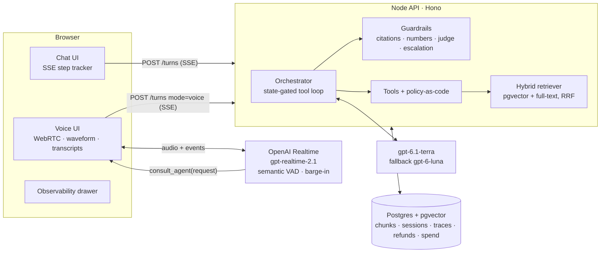

# Nova · Northstar customer-support agent (chat + live voice)

A full-stack support agent for a fictional SaaS (Northstar, cloud storage & collaboration) that answers policy questions from a RAG knowledge base, verifies customers, issues refunds within policy, updates accounts and hands off to humans, over **streaming chat** and **live voice**, with an observability drawer that shows every prompt, tool call, guardrail decision, latency and cost.

**Live demo:** `https://<SITE_DOMAIN>` · **Walkthrough:** `<Loom link>`

> Demo accounts (fake data) are listed in the app under **Demo accounts**. Try `maya@brightloop.io` / PIN `4821` and ask for a refund of your latest invoice, or `dev@quantafoods.com` / `7310` to see an over-limit refund go to a human.

---

## The one idea: one brain, two mouths

Chat and voice share **one orchestrator, one tool layer, one set of guardrails and one session**. The realtime voice model is only the voice. Its single tool is `consult_agent`, which calls the same agent turn the chat uses. A policy fix ships to both channels at once, voice can't skip a guardrail, and switching modes mid-conversation keeps full context because both write to the same session.



## How a turn works

```
context (code) → LLM picks tools → tools enforce policy → … → respond → guardrails → release
```

1. **Code runs before the model.** It loads session facts (verified customer, refunds, tickets) and checks the hard rules: legal or chargeback language, "talk to a human", and a locked verification. If one fires, the model is told a ticket is required, and validation won't release an answer until one exists.
2. **A bounded, state-gated loop** (`packages/agent/src/orchestrator.ts`, max 7 steps). The model chooses the tools, but **which tools exist is decided by state**, not by the prompt (`availableTools`):
   - unverified → `verify_customer`, `search_policies`, `create_escalation_ticket`
   - verified → also `update_account_field`
   - verified *and* the refund policy was consulted → also `issue_refund`

   An unverified session cannot call `issue_refund`, however the request is phrased.
3. **Tools enforce policy in code** (`packages/tools/src/policy.ts`, `tools.ts`). Refund windows, per-tier support limits, duplicate-charge rules, past-due blocks and the "one refund per 30 days" rule live in a pure function, `refundDecision`, with unit tests. If a human must approve, the tool says so (`requiresHuman`) instead of the model improvising. Refunds carry an idempotency key `(session, invoice)`, so retries, replays and barge-ins can't pay twice.
4. **Every answer is validated before anyone sees it.** In voice you can't un-say a sentence, so both channels release only validated text (see Guardrails). A failed check goes back to the model as tool feedback, with at most 2 repairs. If it still fails, there is a safe fallback, an escalation ticket when a rule requires one.
5. Every step streams to the UI as typed SSE events (`packages/shared/src/events.ts`): `step.started` / `step.retry` / `step.completed` / `guardrail` / `message.*` / `escalated` / `trace`.

Example (real output, `pnpm chat`):

```
> maya@brightloop.io, PIN 4821
  ▶ Verifying identity & account tier      ✓ Verified Maya Chen · pro (monthly) · contract active
  ▶ Searching knowledge base               ✓ 5 passages · best 0.72 (high) · refund-policy
    🛡 retrieval_confidence pass 0.721
  ▶ Processing refund                      ✓ Refunded $79.00 on INV-1042 (RF-81F44C)
    🛡 number_provenance pass — Verified: 79, 5, 10
< Your $79 refund for invoice INV-1042 has been issued. It should arrive on your original payment method in 5–10 business days.
  ⏱ 6.6s · 4 LLM / 3 tools · 6368+189 tok · $0.0056 · refund_issued
```

## RAG and grounding

**Corpus:** 14 support docs (refunds, pricing, billing, SLA, security, troubleshooting, …), with tier applicability declared in frontmatter and per section (`<!-- tiers: pro -->`).

**Chunking** (`packages/rag/src/chunker.ts`): structure-aware, not fixed windows.
- **Never cross an H2/H3 boundary**, and prefix every chunk with its breadcrumb (`Refund Policy > Pro plans > Annual billing`). Policy clauses keep their conditions in the same paragraph. A 512-token window that separates "within 30 days" from "Pro monthly" retrieves half a truth.
- **Tables are split by row, and each row is rendered with its header** (`Plan: Pro | API requests/min: 600`). One row is one self-contained fact. That's the unit a customer asks about, and it embeds cleanly.
- Long sections split on paragraph boundaries (~350 tokens) with a one-paragraph overlap. The result is 151 chunks with a median of 70 tokens: small and precise, because support questions are narrow.

**Retrieval** (`retriever.ts`): pgvector cosine plus Postgres full-text (OR over meaningful terms), fused with **Reciprocal Rank Fusion**. Vectors catch paraphrase ("get my money back" ≈ refund); full-text catches tokens that embeddings blur (`E-4410`, plan names).

- **Tier handling:** search once, then *partition* the results in code into chunks *eligible* for the customer's tier and *other-plans-only* matches. That lets the agent say "SSO is an Enterprise feature" instead of "I don't know".
- **Confidence** is the best cosine similarity among eligible chunks. RRF scores are rank-based and aren't comparable across queries, so they're used only for ordering.

**Thresholds are calibrated, not guessed** (`pnpm calibrate` → [`evals/results/calibration.md`](evals/results/calibration.md)). Over 73 labelled queries (43 in-scope, 30 out-of-scope):

| | |
|---|---|
| recall@5 (expected doc in top 5) | **43/43** |
| **τ_low = 0.50** (false-accept ≤ 10%) | accepts 98% in-scope, 10% out-of-scope |
| **τ_high = 0.63** | no out-of-scope query scored above it |

The 10% that slip past τ_low are the interesting part. *"What is the refund policy for the **Ultra** plan?"* scores **0.616**: it is topically identical to the refund policy, but the Ultra plan doesn't exist. **Similarity measures topic, not answerability**, so a threshold alone can't be the guardrail.

**Guardrails** (`packages/agent/src/guardrails.ts`), run on every `respond`:

| layer | what it checks | on failure |
|---|---|---|
| retrieval gate | best similarity < τ_low → passages are withheld from the model | must decline or offer a human |
| citation integrity | grounded answers must cite chunk ids retrieved *this turn* | repair |
| grounding judge | in the grey zone (τ_low ≤ s < τ_high), a small model checks every claim against the cited text, and **fails closed** if the judge is unavailable | repair, then fallback |
| number provenance | every number in the answer (prices, days, limits, %) must appear in a passage, tool result or the customer's own words | repair |
| tool policy | the answer can't claim a refund the billing tool didn't commit | repair |
| escalation policy | if a rule or tool says "human", a ticket must exist before release | repair, then auto-ticket |

## Voice

Voice uses the OpenAI Realtime API (`gpt-realtime-2.1`, voice `marin`) over **WebRTC directly between the browser and OpenAI**. That gives the lowest latency, plus built-in echo cancellation, semantic VAD and barge-in. The server only mints a 2-minute **ephemeral client secret** with the session config baked in, so the API key never reaches the browser.

- **Interruptions:** `interrupt_response` is on, so OpenAI truncates Nova's audio the moment the customer speaks. The UI marks that line *interrupted*, aborts any in-flight `consult_agent` turn, and tells the model the call was cancelled so it answers the new utterance. Persisted transcripts are what was *actually* said, so the next turn knows an answer was cut off. A refund already committed before an interruption stays committed (idempotent), and the agent's session facts say so.
- **Latency budget:** for anything factual, the model says a 2–5 word acknowledgement ("Sure, let me check.") before it calls `consult_agent`. The step tracker lights up for voice turns exactly as it does for chat.
- **Shared session:** the realtime instructions include the recent conversation and the verified customer, so you can start in chat, switch to voice and ask "what did you just refund me?".

## Resilience

Each failure below can be triggered from the UI's **Chaos** menu, so you can watch the recovery live.

| failure | behaviour |
|---|---|
| LLM 429 | honours `retry-after` (capped), retries the same model; the step shows `↻ rate limited, retry-after 1.5s` |
| LLM timeout / 5xx | retries once on the **fallback model** (`gpt-6-luna`); a slow primary shouldn't hold the customer |
| flex capacity error | drops to the default tier |
| all retries exhausted | error card with **Retry** (the server de-duplicates the user message) and **Talk to a human**; nothing is lost |
| tool failure (transient) | one automatic retry after 500 ms |
| tool failure (permanent) | the model is told the action didn't happen; validation stops it claiming success; it offers a ticket |
| knowledge base down | policy answers are refused rather than answered from memory |
| voice drops / mic denied | falls back to chat with the transcript intact |
| client disconnects mid-turn | the turn is aborted; facts committed so far (e.g. a refund) are persisted |

## Observability

Every turn records a span tree (`TurnRecorder`): each LLM call (model, tier, attempt, tokens, cost, the exact prompt input), each tool (args with the PIN redacted, results), retrieval (candidates with similarity, RRF score and tiers; timings) and guardrail verdicts. On top of that come end-to-end latency, time-to-first-status and answer-ready time. Traces are stored in Postgres and streamed to the drawer. Realtime audio usage is reported from `response.done` events and priced from the same table (`packages/shared/src/pricing.ts`).

## Evals

`pnpm eval` runs **60 end-to-end cases** ([`evals/cases.jsonl`](evals/cases.jsonl)) through the real orchestrator, tools, retriever and guardrails. The categories are policy Q&A, tier-specific answers, out-of-scope traps, actions for every persona, adversarial attempts (prompt injection, PIN fishing, fake policy, other customers' data) and escalation. Latest [`report.md`](evals/results/report.md):

| | |
|---|---|
| cases passed | **60/60** |
| escalation precision / recall | **100% / 100%** |
| out-of-scope questions answered anyway | **0/10** |
| refunds issued that policy didn't allow | **0** |
| turns where a guardrail rejected a draft (then repaired) | 10/96 |
| turn latency p50 / p95 | 2.7 s / 6.5 s |

The first run scored 54/60. Three failures were real bugs, fixed in the prompt and tools: general policy questions were wrongly gated behind verification; the agent judged a refund window itself instead of letting the billing tool decide; Enterprise refund tickets went to the wrong queue. Three expectations were too strict and were relaxed after reading the answers. In each, the behaviour was correct but phrased differently (e.g. "when your current term ends" vs "at renewal"). That's recorded here rather than hidden.

**Cost-aware eval infra.**
- Evals run on the **flex** service tier (half price), with a disk cache of LLM responses keyed by request hash, so re-running unchanged cases is free. A full uncached run costs about **$0.09**.
- `pnpm audit:batch` re-judges every substantive reply with a stronger model via the **Batch API** (another 50% off), against exactly the evidence the agent saw. Batch fits there because each judgement is independent; it can't drive the agent loop itself, where every step depends on the previous one.

## Production readiness

- **Rate limits** (per IP, token bucket): turns/min, sessions/hour, voice sessions/hour; 429 responses include `Retry-After`.
- **Spend caps:** a hard daily budget across all sessions plus a per-session cap, enforced before every LLM call. A public demo can't drain the key.
- **Secrets:** only `.env.example` is tracked. The gitleaks pre-commit hook and a CI scan block keys; the browser only ever sees ephemeral realtime secrets.
- **Supply chain:** pnpm `minimumReleaseAge: 7 days` (no freshly-published package versions) and an allowlist for install scripts.
- **Deploy:** two containers (pgvector at 256 MB, API at 320 MB) bound to localhost, behind the host's nginx with a Cloudflare origin cert, running on a 2 GB ARM instance shared with other services. The static web build is served by nginx. `deploy/deploy.sh` does the whole thing.

## Trade-offs

- **A custom state machine instead of LangGraph.** It's a few hundred lines you can read end to end, preconditions are plain typed code, and there are no hidden retries. LangGraph would add checkpointing and visual graphs I didn't need at this size.
- **Validate-then-release instead of token streaming of the answer.** The answer appears ~1 s later than raw streaming would allow, but a hallucinated refund amount can never flash on screen and then be retracted, and voice can't un-say anything. Step events stream from the first millisecond, so the UI is never idle.
- **The realtime model as the mouth, not the brain.** That adds one hop of latency on factual turns (covered by the spoken acknowledgement) in exchange for a single policy engine. The alternative is giving the realtime model the tools directly: faster, but then two brains drift apart and voice gets weaker guardrails.
- **Postgres for everything.** At 151 chunks any vector store works. The app needs transactional state anyway (sessions, idempotent refunds, spend ledger, traces), and pgvector adds hybrid search and metadata filters in one SQL statement and one service. HNSW indexes cover the scale-up path.
- **Single instance.** Rate limits and per-session budgets are in memory; scaling out means moving them to Redis.

## Repo layout

```
apps/api            Hono API: SSE turns, sessions, voice token, rate limits, budgets
apps/web            Next.js UI: chat, voice (WebRTC), observability drawer
packages/shared     zod domain model + SSE event protocol + pricing (shared by API and web)
packages/agent      orchestrator, LLM client (retries/fallback/flex/cache), guardrails, prompts, tracing
packages/tools      tools, policy-as-code, mock customer system, refund ledger
packages/rag        chunker, embeddings, hybrid retriever, ingestion
data/corpus         14 support policy documents       data/fixtures   mock customers + demo hints
evals               cases, retrieval labels, calibration, eval runner, batch audit, results
db/schema.sql       one schema, idempotent             deploy/         nginx site, deploy script
```

## Run locally

```bash
cp .env.example .env              # add OPENAI_API_KEY
docker compose up -d db           # Postgres + pgvector on :5433
pnpm install
pnpm db:migrate && pnpm ingest    # schema + embed the corpus (~$0.0002)
pnpm dev                          # api :8080 + web :3000
pnpm test                         # unit tests (policy, gating, chunker, guardrails) — no API calls
pnpm calibrate && pnpm eval       # thresholds + end-to-end evals (flex tier, cached)
pnpm chat "What are the API rate limits on Pro?"   # terminal client
```
